# DeepSeek Harness Docker

> 📌 **版本信息**：兼容支持官方 DeepSeek Harness 核心 `0.2.1-rc.3` / `0.2.1-rc.2` / `0.2.1-alpha.5` / `0.2.1-alpha.4` / `0.2.1-alpha.3` / `0.2.1-alpha.2` / `0.2.1-alpha.1` / `0.2.0-rc.2` / `0.2.0-rc.1` / `0.1.7-rc.2` / `0.1.7-rc.1` / `0.1.7-alpha.2` / `0.1.7-alpha.1` / `0.1.6-alpha.2` / `0.1.6-alpha.1` / `0.1.5-rc.2` / `0.1.5-rc.1` / `0.1.2-rc.1` ｜ 本项目工程版本 `0.2.9`  
> 🔗 **快速直达链接**：
> - ⚡ **官方 DSH 仓库**：[deepseek-ai/deepseek-harness](https://github.com/deepseek-ai/deepseek-harness) ｜ [官方 Releases 更新日志](https://github.com/deepseek-ai/deepseek-harness/releases) ｜ [npm 官方包页](https://www.npmjs.com/package/@deepseek-ai/dsh)
> - 📦 **本项目 Docker 仓库**：[misaka-link/deepseek-harness-docker](https://github.com/misaka-link/deepseek-harness-docker) ｜ [本项目 Releases](https://github.com/misaka-link/deepseek-harness-docker/releases)
> 🏷️ **镜像标签规范**：默认拉取镜像统一提供 **`:latest`**（完整纯净版）、**`:latest-market`**（预装市场版）与 **`:latest-mini`**（轻量无浏览器版），开箱即用；其中 **`mini` 镜像支持 `linux/amd64` 与 `linux/arm64` 双架构 Multi-Arch Manifest**（根据主机平台架构自动拉取适配），**明确 ARM 版只有 mini，暂不增加其他变体**（`full` / `market` 仅支持 `linux/amd64`）。每次构建镜像时，**均会额外多打两个版本标签**：  
> 1. **额外标签一：内置官方 DeepSeek Harness 版本标签**（如 `:0.2.1-rc.3`、`:0.2.1-rc.3-market`、`:0.2.1-rc.3-mini`），精确锁定底层 DSH 官方引擎；  
> 2. **额外标签二：本项目自身的工程版本标签**（如 `:0.2.8`、`:0.2.8-market`、`:0.2.8-mini`），精确锁定本容器套件自身的版本。

专为官方 DeepSeek Harness 打造的**开箱即用容器化套件与可视化 Web Admin 控制台**。基于 **Debian 13 (Trixie) & Node 24 (glibc 2.41)** 现代化运行时底座，一键解决官方回环网络限制、解耦全局 `NODE_ENV` 恢复纯净开发环境、集成轻量访问认证与 noVNC 静态版本化桌面；并通过**全新的 Web Admin 三栏核心看板与安全迁移体系**，实现 DSH 核心版本在线热切换、全自动快照备份、社区插件市场管理与可视化运维；同时**内置「DSH 容器助手」插件**（移动端视口防黑屏适配、接管官方远程登录弹窗、登录态检测与手机号隐私打码）。

简单来说：**Debian Trixie 现代底座，自带强大 Admin 控制台，Docker 一键梭哈，开箱即用。**

---

## 🎛️ 核心亮点：强大好用的 Web Admin 控制台展示

本项目核心特色在于内置了功能完备、极简美观的 Web 管理控制台（访问 `/admin/` 即可进入）：

| 1. DSH 核心版本状态看板与顶栏直达 | 2. 顶栏版本更新速览与 DSH 适配芯片 |
| :---: | :---: |
| 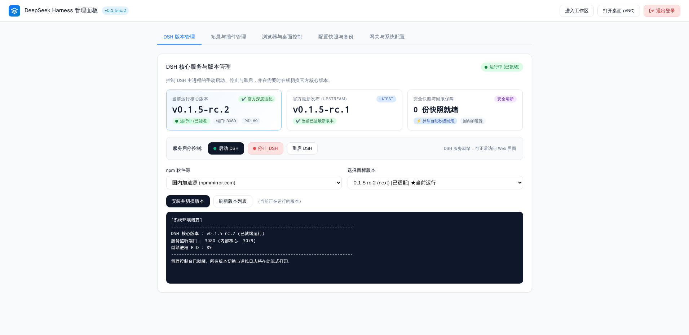 | 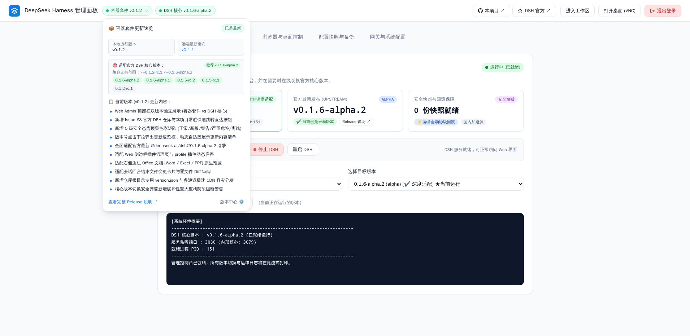 |
| 实时呈现当前核心版本、运行状态、端口/PID，动态探测官方最新发布，顶栏常驻官方与本项目 GitHub 直达入口 | 点击顶栏版本徽章弹出更新速览卡片框，自适应展示版本更新内容清单与官方 DSH 引擎适配支持范围芯片 |

| 3. 宽屏双栏版本与更新控制中心 | 4. 安全备份与版本防呆预警模态弹窗 |
| :---: | :---: |
| 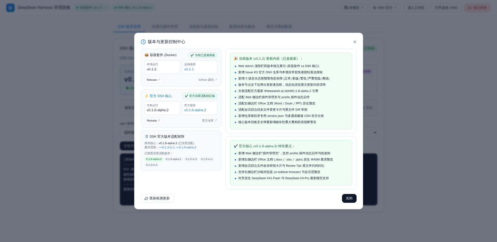 | 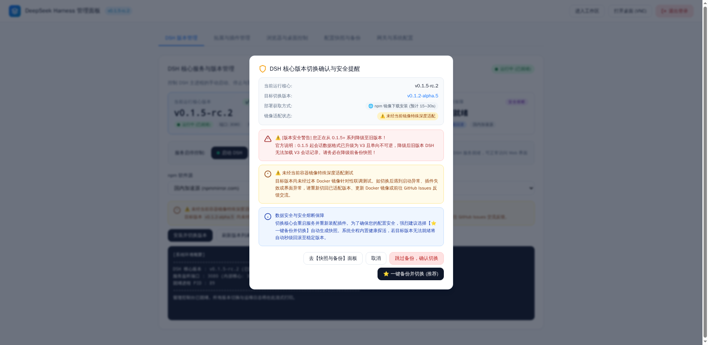 |
| 左右双栏宽屏栅格排版，左侧整合套件/核心双版本状态与 DSH 适配矩阵，右侧通栏呈现完整更新要点，超长内容自适应滚动 | 切换前自动触发秒级快照备份，包含版本差异比对、官方 V3 会话格式不可逆降级保护告警与破坏性重构防呆阻断 |

| 5. Chromium 浏览器与虚拟桌面控制 | 6. 配置快照与一键备份还原 |
| :---: | :---: |
| 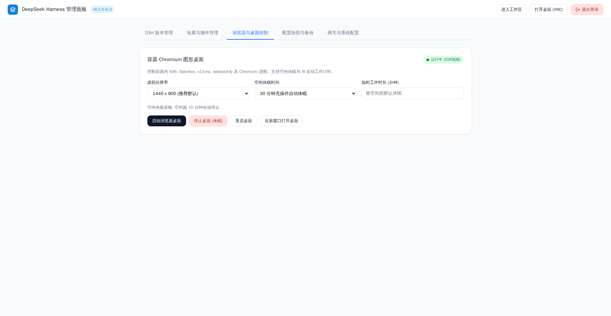 | 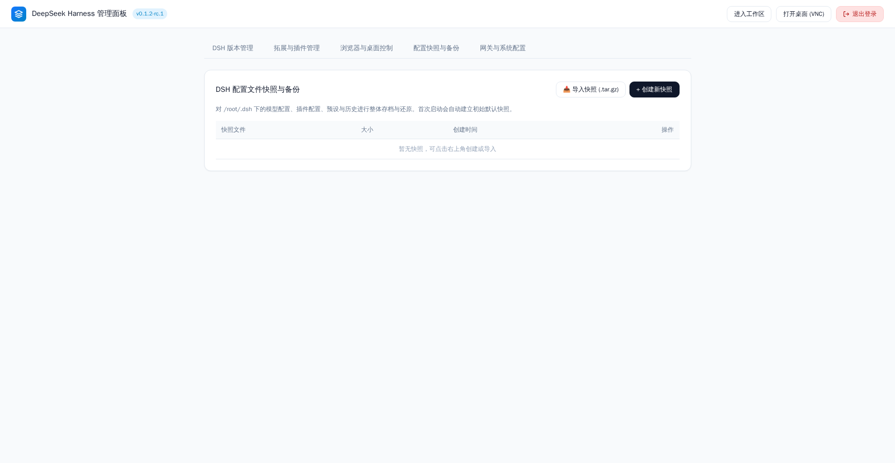 |
| 动态切换 1080p/2K 分辨率、CDP 9222 远程调试开关、桌面空闲超时休眠与一键唤醒 | 一键生成 `/root/.dsh` 全量配置快照，支持自动定时备份、秒级恢复出厂配置与快照导出 |

| 7. 网关与系统安全配置 | 8. 容器内置真实 Chromium noVNC 桌面 (`/vnc/`) |
| :---: | :---: |
| 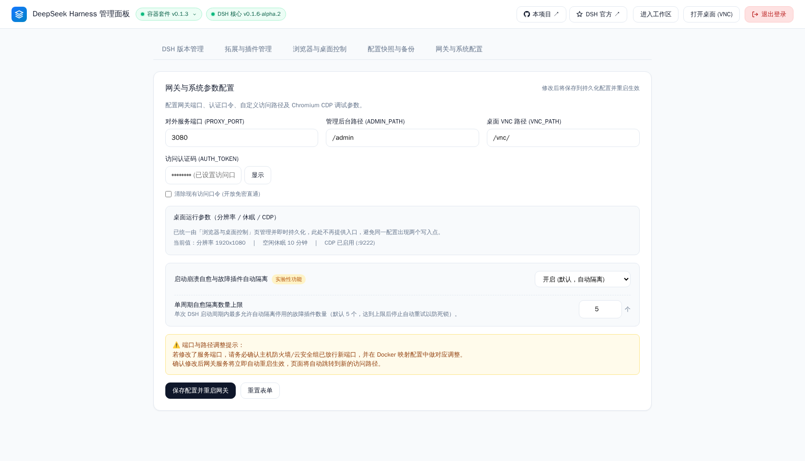 | 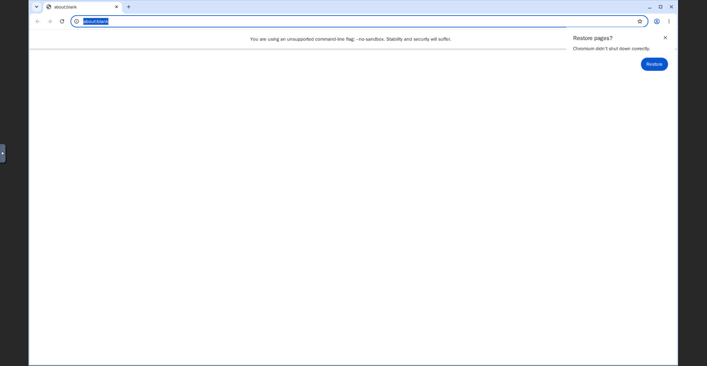 |
| 热修改访问认证码、自定义后台管理路径与桌面路径、反向代理与安全频率限制 | 静态资源版本化隔离，配合 `dsh-browser-desktop` 插件，AI 可自主操控网页与实时截屏 |

| 9. 极简访问认证页 (默认口令: `admin`) | 10. 官方 DSH Web 交互工作区 (最新 0.2.1-rc.3) |
| :---: | :---: |
| 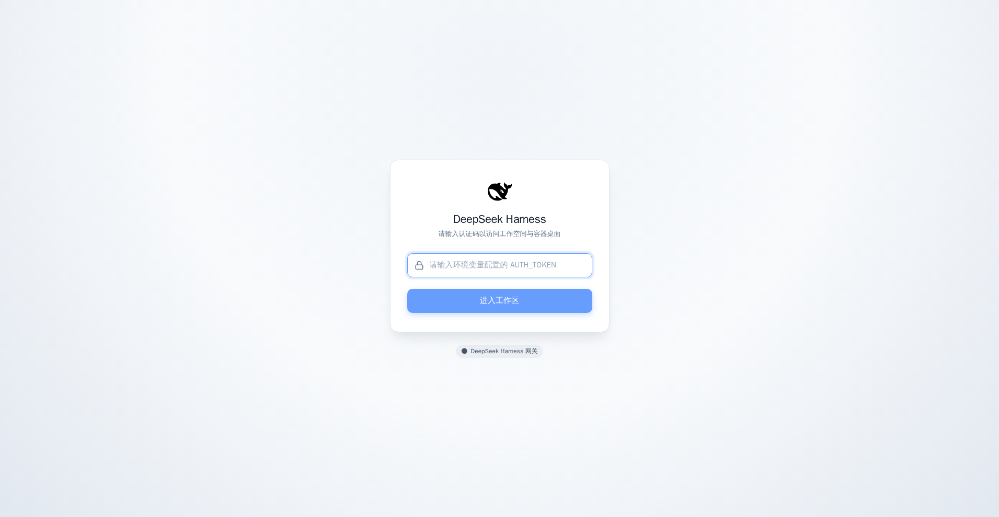 | 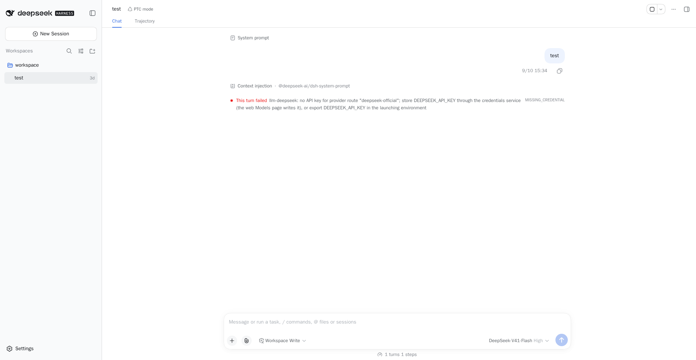 |
| 告别原生丑陋 Basic Auth 弹窗，采用 DSH 同源灰白科技质感，单输入框极速登录 | 彻底根治回环网络限制与模型配置报错，完美支持 DeepSeek-V41-Flash 等最新模型 |

| 11. 内置 DeepSeek 远程登录助手插件弹窗 | 12. 登录态检测与手机号隐私打码 |
| :---: | :---: |
| 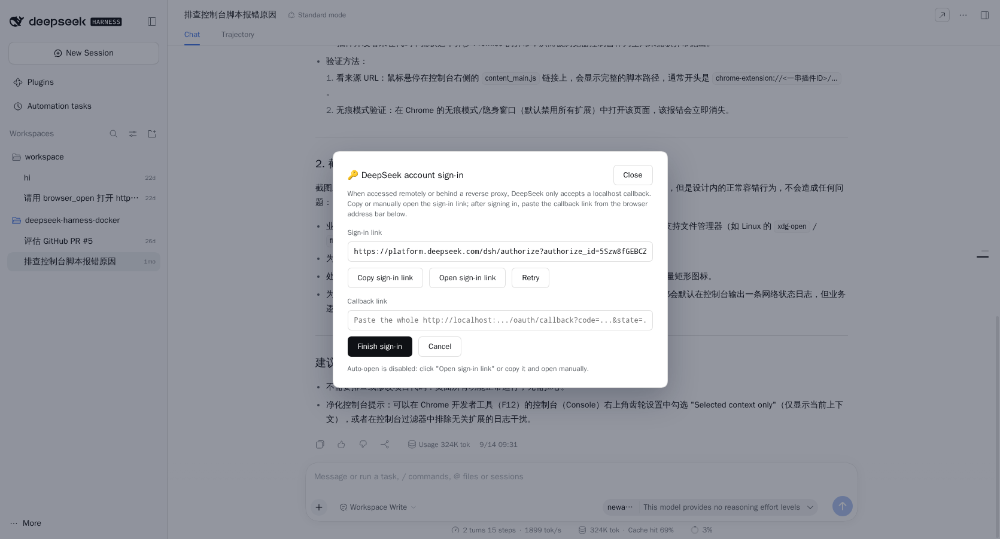 | 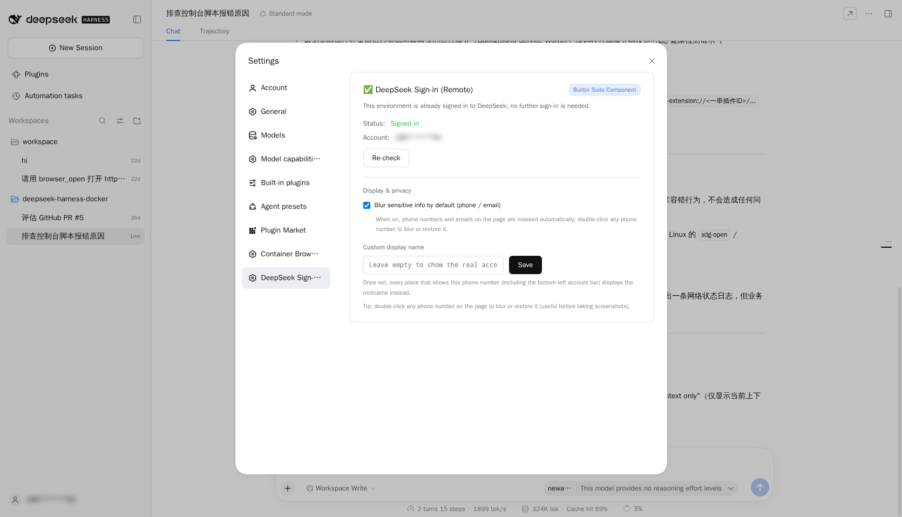 |
| 接管官方登录弹窗并**关闭自动跳转**：左下角账号菜单「Sign in」直接弹出，可复制或点击打开登录链接，并在下方粘贴回调链接一键完成（平台只接受 loopback 回调，无需手改 host） | 读容器内本地凭据判定登录态，**已登录时不再展示登录框**；并支持 **双击手机号模糊/还原**、默认模糊与自定义显示昵称 —— 截图中账号与左下角账号栏均已打码 |

*(注：上述控制台与工作区功能中，第 5、8 项桌面与容器 Chromium 相关能力仅在 full / market 镜像中提供，mini 镜像默认关闭并深度精简)*

---

## 📦 镜像版本选择与标签说明

本项目提供三种官方预构建镜像，默认推荐直接以 **`:latest`** / **`:latest-market`** / **`:latest-mini`** 运行；同时每次构建都会额外自动发布 **内置 DSH 版本标签** 与 **本项目工程版本标签** 供精确追溯：

| 镜像分类 | 默认镜像标签 (推荐，开箱即用) | 额外标签一：内置 DSH 官方版本 (锁定底层引擎) | 额外标签二：本项目工程版本 (锁定容器套件) | 支持架构 | 特性与适用场景 |
|---|---|---|---|---|---|
| **轻量精简版 (Mini)** *(Issue #11)* | **`ghcr.io/misaka-link/deepseek-harness-docker:latest-mini`** | `...:0.2.1-rc.3-mini`<br>(`...:dsh-0.2.1-rc.3-mini`) | `...:0.2.9-mini`<br>(`...:v0.2.9-mini`) | **`linux/amd64`**<br>**`linux/arm64`**<br>*(ARM 仅 mini)* | **极致精简（实测 1.79GB（amd64）/ 1.82GB（arm64），原 5.3GB、缩减约 66%）**：去 Chromium/noVNC 桌面栈、去 AI 浏览器控制工具、去 Golang/gh CLI、剥离 Office wasm 与本地语音识别库；管理后台自动收敛隐藏桌面控制。**适合纯文本代码开发、低配 VPS、Apple Silicon/ARM64 机器与资源敏感型部署**；不适用需要 AI 操控浏览器进行网页抓取/截屏的场景 |
| **基础纯净版** | **`ghcr.io/misaka-link/deepseek-harness-docker:latest`** | `...:0.2.1-rc.3`<br>(`...:dsh-0.2.1-rc.3`) | `...:0.2.9`<br>(`...:v0.2.9`) | `linux/amd64`<br>*(仅 amd64)* | **完整纯净开发环境 (~5.3GB)**：仅包含官方 DSH 核心、统一网关、访问认证、Chromium 桌面环境、Golang 与 gh CLI 工具链，轻量精简，插件可后续在后台按需安装 |
| **预装插件商店版** | **`ghcr.io/misaka-link/deepseek-harness-docker:latest-market`** | `...:0.2.1-rc.3-market`<br>(`...:dsh-0.2.1-rc.3-market`) | `...:0.2.9-market`<br>(`...:v0.2.9-market`) | `linux/amd64`<br>*(仅 amd64)* | **开箱即用 (~5.3GB)**：在基础版上**预装社区应用市场 (`dshmarket`)** 与思考强度调节等常用插件，免去手动安装；预装插件跟随 `@latest`，每次构建镜像时自动拉取最新版 |

---

## 🪶 Mini 镜像快速启动

针对低配 VPS、云服务器、纯代码/文本 Agent 以及各类 ARM 架构设备，推荐直接使用轻量精简镜像 `ghcr.io/misaka-link/deepseek-harness-docker:latest-mini`。

单行命令极速拉起运行：

```bash
docker run -d \
  --name deepseek-harness-mini \
  --restart unless-stopped \
  -p 3080:3080 \
  -e AUTH_TOKEN=admin \
  -v $PWD/data/dsh:/root/.dsh \
  -v $PWD/workspace:/workspace \
  -v $PWD/data/snapshots:/root/.dsh-snapshots \
  ghcr.io/misaka-link/deepseek-harness-docker:latest-mini
```

- ⚠️ **数据卷挂载重要说明**：**不要挂载 `./data/browser`**！Mini 镜像已彻底剥离容器内 Chromium 与桌面栈，挂载浏览器数据卷不仅毫无作用，还会生成冗余空目录。
- 🌍 **ARM64 主机可直接拉取**：同一标签 `latest-mini` 内置 `linux/amd64` 与 `linux/arm64` 双架构 Multi-Arch Manifest，ARM64 宿主机（如 Apple Silicon Mac、树莓派等）执行上述命令时，Docker 会自动识别并拉取适配的 ARM64 镜像，无需任何特殊架构后缀。
- 🔗 **快速访问入口**：
  - **DSH Web 交互工作区**：`http://<服务器IP>:3080/`
  - **Web Admin 管理后台**：`http://<服务器IP>:3080/admin/`（已自动收敛隐藏桌面控制入口，纯净清爽）
  - **默认访问认证码**：`admin`（首次登录后可在管理后台随时修改）

---

## 🧱 Mini 镜像编排（docker-compose.mini.yml）

对于生产部署或需要持久化管理的环境，推荐使用项目根目录下自带的专属编排文件 [`docker-compose.mini.yml`](docker-compose.mini.yml)。

### Compose 文件关键配置片段
```yaml
services:
  deepseek-harness:
    image: ghcr.io/misaka-link/deepseek-harness-docker:latest-mini
    container_name: deepseek-harness-mini
    restart: unless-stopped
    ports:
      # 仅暴露单个统一端口（Web 与 Admin 共享）
      - "${PROXY_PORT:-3080}:${PROXY_PORT:-3080}"
    environment:
      - AUTH_TOKEN=${AUTH_TOKEN:-admin}
      - PROXY_PORT=${PROXY_PORT:-3080}
      - DSH_HOME=${DSH_HOME:-/root}
      - DSH_VERSIONS_MIN_FREE_MB=${DSH_VERSIONS_MIN_FREE_MB:-1536}
    # ── M11 容器安全加固与最小权限 ─────────────────────────────────
    security_opt:
      - no-new-privileges:true
    cap_drop:
      - ALL
    cap_add:
      - CHOWN
      - DAC_OVERRIDE
      - FOWNER
      - SETUID
      - SETGID
      - KILL
    volumes:
      # 1. DSH 系统与配置目录（会话、配置、插件）
      - ./data/dsh:/root/.dsh
      # 2. 独立项目工作区目录
      - ./workspace:/workspace
      # 3. 配置文件快照与备份存档目录
      - ./data/snapshots:/root/.dsh-snapshots
```

### 常用编排管理命令
```bash
# 启动 Mini 镜像服务（后台运行）
docker compose -f docker-compose.mini.yml up -d

# 停止 Mini 容器并清理容器网络（若需连带清理匿名数据卷可加 -v）
docker compose -f docker-compose.mini.yml down -v
```

### 与标准 `docker-compose.yml` 的核心差异
1. **彻底去除 `./data/browser` 卷挂载**：Mini 镜像内不包含 Chromium，去除宿主机上的浏览器配置目录映射，防止污染宿主机；
2. **净化桌面相关配置**：去除 Chromium 远程调试端口、桌面分辨率环境变量，避免冗余配置干扰；
3. **安全加固体系一致**：完整继承 `no-new-privileges` 与精简 `cap_add` 最小权限集合，安全边界与 Full 镜像完全一致。

---

## 🖥️ ARM64 支持说明

本项目针对 Apple Silicon（M1/M2/M3/M4 Mac）、树莓派、香橙派、RK3588 以及华为鲲鹏、飞腾等各类 ARM64 设备提供原生适配：

- ⚠️ **架构边界**：**ARM 版只有 mini，暂不增加其他变体**！完整版（`full`）与市场版（`market`）目前仅提供 `linux/amd64` 镜像；**仅 `mini` 镜像构建并发布了 `linux/amd64` 与 `linux/arm64` 双架构 Multi-Arch Manifest**。ARM 主机请始终拉取运行 `latest-mini`，切勿尝试在 ARM64 环境下通过 QEMU 模拟跨架构运行 full 镜像，避免引发极端性能损耗或原生模块崩溃。
- 🔍 **ARM64 运行验证命令**：
  在 ARM64 宿主机拉取并启动容器后，可通过以下命令验证底层架构与原生二进制模块：
  ```bash
  # 1. 验证宿主机内核架构（确认输出 aarch64 或 arm64）
  uname -m

  # 2. 检查本地拉取镜像的实际架构（应输出 arm64）
  docker image inspect ghcr.io/misaka-link/deepseek-harness-docker:latest-mini -f '{{.Architecture}}'

  # 3. 验证容器内 Node.js 运行时进程的原生架构（输出 arm64，非 QEMU 模拟的 x64）
  docker run --rm ghcr.io/misaka-link/deepseek-harness-docker:latest-mini node -p process.arch

  # 4. 验证原生模块（node-pty）在 arm64 正常加载运行
  docker run --rm ghcr.io/misaka-link/deepseek-harness-docker:latest-mini node -e "require('node-pty')"
  ```
- ⚠️ **低配 ARM 设备构建注意事项**：
  若在类似 865bt（高通骁龙 865 移植 Linux）或低配单板机等物理 ARM 设备上进行**本地镜像构建**，宿主机**必须预留 ≥3GB 空闲内存**。构建期间原生编译 `node-pty`、`sharp`、`@vscode/ripgrep` 等 C/C++ 原生模块以及安装 DSH 核心包时内存消耗较高，曾因内存不足触发 Linux 内核 OOM-killer 中断构建。

## 🚀 Docker 一键梭哈

### 1. 单行命令极速启动 (推荐)

#### 选项 A：启动基础纯净版 (默认 `:latest`)
```bash
docker run -d \
  --name deepseek-harness \
  --restart unless-stopped \
  -p 3080:3080 \
  -e AUTH_TOKEN=admin \
  -v $(pwd)/data/dsh:/root/.dsh \
  -v $(pwd)/workspace:/workspace \
  -v $(pwd)/data/snapshots:/root/.dsh-snapshots \
  -v $(pwd)/data/browser:/root/.config/chromium \
  ghcr.io/misaka-link/deepseek-harness-docker:latest
```
*(若需精准锁定，亦可将标签指定为内置 DSH 版本 `:0.2.1-rc.3` 或项目版本 `:0.2.9`)*

#### 选项 B：启动预装插件商店版 (默认 `:latest-market`，开箱即带 dshmarket 插件市场)
```bash
docker run -d \
  --name deepseek-harness-market \
  --restart unless-stopped \
  -p 3080:3080 \
  -e AUTH_TOKEN=admin \
  -v $(pwd)/data/dsh:/root/.dsh \
  -v $(pwd)/workspace:/workspace \
  -v $(pwd)/data/snapshots:/root/.dsh-snapshots \
  -v $(pwd)/data/browser:/root/.config/chromium \
  ghcr.io/misaka-link/deepseek-harness-docker:latest-market
```
*(若需精准锁定，亦可将标签指定为内置 DSH 版本 `:0.2.1-rc.3-market` 或项目版本 `:0.2.8-market`)*

#### 选项 C：启动轻量精简版 (默认 `:latest-mini`，无浏览器，实测 1.82GB，支持 amd64/arm64)
```bash
docker run -d \
  --name deepseek-harness-mini \
  --restart unless-stopped \
  -p 3080:3080 \
  -e AUTH_TOKEN=admin \
  -v $PWD/data/dsh:/root/.dsh \
  -v $PWD/workspace:/workspace \
  -v $PWD/data/snapshots:/root/.dsh-snapshots \
  ghcr.io/misaka-link/deepseek-harness-docker:latest-mini
```
*(注：Mini 镜像无需挂载 `./data/browser` 目录；ARM64 主机直接支持自动选架构；若需精准锁定，亦可将标签指定为内置 DSH 版本 `:0.2.1-rc.3-mini` 或项目版本 `:0.2.8-mini`；完整说明详见上方 [Mini 镜像快速启动](#-mini-镜像快速启动))*

启动完成后直接访问：
- **Web Admin 管理面板**：`http://<服务器IP>:3080/admin/` ⭐
- **DSH Web 交互工作区**：`http://<服务器IP>:3080/`
- **容器 Chromium 桌面**：`http://<服务器IP>:3080/vnc/` *(仅 Full / Market 镜像可用，Mini 镜像硬闸阻断返回 404)*
- **默认认证码**：`admin`（登录后可在后台随时修改）

#### 🔑 DeepSeek 账号登录（远程 / 反代访问必读）

DSH 官方 0.2.1-alpha.3 起支持在 Web 端登录 DeepSeek 账号（免 API Key 使用官方模型）。该能力受**平台侧硬约束**：DeepSeek 平台只接受 **loopback 回调地址**（`http://localhost|127.0.0.1|[::1]:<端口>/oauth/callback`），非 loopback 域名/IP 的 `redirect_uri` 会被平台直接拒绝（返回 `PAYLOAD_SCHEMA_MISMATCH`）。

本套件为此做了两处适配：内置补丁把回调 origin 归一到 `http://localhost:<端口>`，使远程/域名访问下也能**发起**登录；网关放行 `/oauth/callback`（由 DSH 自行校验 `state`/`code`）。**完成登录有两种方式**：

1. **本地隧道（推荐，全自动）**：`ssh -L 3080:127.0.0.1:3080 <user>@<服务器IP>`，然后用浏览器打开 `http://localhost:3080/` 发起登录 —— 回调自动落回本机 `localhost`，全流程无感。
2. **内置插件弹窗（远程用户推荐）**：DSH 内置插件已**接管官方登录弹窗**（设置中心「DeepSeek 登录（远程）」，或在「设置 → 模型」触发登录时弹出），配色与 DSH 一致，且**已关闭自动跳转**——可**复制登录链接**或**点击打开登录链接**；登录后浏览器会跳向 `http://localhost:<端口>/oauth/callback?code=...&state=...`（本机打不开属正常），把地址栏里的**整段链接粘贴到弹窗的「回调链接」输入框**，点「完成登录」即可，**无需手改 host**。
   - 同一入口也可直接用网页版：`http://<服务器IP>:3080/account/callback`。


---

### 2. Docker 容器编排 (docker-compose)

#### 基础纯净版 (`docker-compose.yml`)：
```yaml
services:
  deepseek-harness:
    image: ghcr.io/misaka-link/deepseek-harness-docker:latest
    container_name: deepseek-harness
    restart: unless-stopped
    ports:
      - "3080:3080"
    environment:
      # 访问认证码（用于登录 Web、Admin 后台与 VNC 桌面，留空则免密）
      - AUTH_TOKEN=admin
      - PROXY_PORT=3080
    volumes:
      - ./data/dsh:/root/.dsh
      - ./workspace:/workspace
      - ./data/snapshots:/root/.dsh-snapshots
      - ./data/browser:/root/.config/chromium
```

#### 预装插件商店版 (`docker-compose.market.yml`)：
```yaml
services:
  deepseek-harness:
    image: ghcr.io/misaka-link/deepseek-harness-docker:latest-market
    container_name: deepseek-harness-market
    restart: unless-stopped
    ports:
      - "3080:3080"
    environment:
      - AUTH_TOKEN=admin
      - PROXY_PORT=3080
    volumes:
      - ./data/dsh:/root/.dsh
      - ./workspace:/workspace
      - ./data/snapshots:/root/.dsh-snapshots
      - ./data/browser:/root/.config/chromium
```

#### 轻量精简版 (`docker-compose.mini.yml`，由构建链配套提供)：
```yaml
services:
  deepseek-harness:
    image: ghcr.io/misaka-link/deepseek-harness-docker:latest-mini
    container_name: deepseek-harness-mini
    restart: unless-stopped
    ports:
      - "3080:3080"
    environment:
      # 访问认证码（用于登录 Web 与 Admin 后台，留空则免密）
      - AUTH_TOKEN=admin
      - PROXY_PORT=3080
    volumes:
      - ./data/dsh:/root/.dsh
      - ./workspace:/workspace
      - ./data/snapshots:/root/.dsh-snapshots
      # 注：Mini 镜像无需挂载 ./data/browser
```

一键启动：
```bash
# 启动基础纯净版
docker compose up -d

# 或启动预装插件商店版
docker compose -f docker-compose.market.yml up -d

# 或启动轻量精简版（新增）
docker compose -f docker-compose.mini.yml up -d
```

---

## ⚙️ 常见环境变量

| 变量名 | 默认值 | 说明 |
|---|---|---|
| `AUTH_TOKEN` | `admin` | 访问认证码（留空则不设密码，放行所有访问） |
| `PROXY_PORT` | `3080` | 统一对外暴露端口（Web、Admin 与 VNC 共用） |
| `ADMIN_PATH` | `/admin` | Web Admin 管理后台访问路径 |
| `VNC_PATH` | `/vnc` | noVNC 图形桌面访问路径 *(仅 full/market 生效，mini 镜像下显式返回 404)* |
| `DSH_WORKSPACE` | `/workspace` | DSH AI 默认工作区目录 |
| `DSH_VARIANT` | `full` | 镜像变体类型（`full`: 完整版 / `mini`: 精简版，构建期烘焙，运行期只读单一真源契约） |
| `DSH_DESKTOP_ENABLED` | `1` | 是否启用内置 Chromium 图形桌面 (1: 开启, 0: 关闭) *(仅 full/market 生效，mini 镜像下忽略)* |
| `DSH_DESKTOP_WIDTH` | `1920` | 桌面宽度分辨率 (支持后台动态调整) *(仅 full/market 生效)* |
| `DSH_DESKTOP_HEIGHT` | `1080` | 桌面高度分辨率 (支持后台动态调整) *(仅 full/market 生效)* |
| `DSH_SCREENSHOT_*` | — | 截图画质与归档子目录等参数 *(仅 full/market 生效)* |
| `HTTP_PROXY` / `HTTPS_PROXY` | 无 | 出站网络代理（DSH 0.1.5-rc.1 起全面原生遵循） |
| `NO_PROXY` | `localhost,127.0.0.1` | 免代理地址列表 |

---

## 🧩 Mini 镜像能力差异与边界说明 (Issue #11)

为响应社区对精简镜像体积的迫切需求（[Issue #11](https://github.com/misaka-link/deepseek-harness-docker/issues/11)），本项目正式推出第三镜像变体 **`latest-mini`**。通过落地 C 档深度瘦身策略（slim 底座、多阶段构建、依赖裁剪与资产瘦身），将原 5.3GB 镜像解压体积压缩至 **实测 1.79GB（amd64）/ 1.82GB（arm64）**（原 5.3GB、缩减约 66%），并支持 **`linux/amd64` 与 `linux/arm64` 双架构**（明确 **ARM 版只有 mini，暂不增加其他变体**）。

### 📋 Full / Market 与 Mini 详细能力对比矩阵

| 维度 / 能力组件 | Full 镜像 (`:latest`) / Market 镜像 (`:latest-market`) | Mini 镜像 (`:latest-mini`) | 变体差异与实现说明 |
|---|---|---|---|
| **解压体积** | 约 5.3GB | **实测 1.79GB（amd64）/ 1.82GB（arm64）** | 原 5.3GB、缩减约 66%，极大降低拉取与磁盘开销 |
| **支持架构** | 仅 `linux/amd64` | **`linux/amd64` + `linux/arm64`** | Mini 提供 Multi-Arch Manifest，ARM64 机器原生运行；明确 ARM 版只有 mini，暂不增加其他变体 |
| **基础底座** | `node:24-trixie` | **`node:24-trixie-slim`**（多阶段构建） | 剔除 Debian 桌面冗余包，同层清理 npm/node-gyp 构建缓存 |
| **容器 Chromium 浏览器** | 内置 (`/usr/bin/chromium`) | **物理移除**（不存在浏览器二进制） | 容器内无浏览器进程与图形依赖 |
| **X11 / noVNC 虚拟桌面** | 内置 (`xvfb`, `x11vnc`, `novnc`, `websockify`) | **物理移除**，`/vnc/*` 请求硬闸返回 404 | 无 5900/6080/9222 端口监听，桌面管理器装配桩对象 |
| **AI 浏览器控制工具** | 提供 `browser_open`, `browser_screenshot`, `browser_control` | **未装配**（插件 `@dsh-custom/dsh-browser-desktop` 不加载） | AI 聚焦代码、命令执行与工作流任务，无 browser_* 工具 |
| **Web Admin 控制台呈现** | 完整呈现「浏览器与桌面控制」Tab、顶栏 VNC 直达入口 | **全量收敛隐藏**，桌面 API 显式返回 403 `CAPABILITY_UNAVAILABLE` | 控制台纯净，DOM 判空防崩保护，深链参数平滑回退 |
| **客户端侧边栏浏览器** | 支持 (`ui-sidebar-browser`) | **完整保留 ✅** | **特别注意区分**：运行于用户本地浏览器沙箱，零容器开销 |
| **Golang 官方开发环境** | 内置最新 Go (`/usr/local/go`) | **不预装** | 运行期如需编译 Go 可通过 `apt` 临时安装 |
| **GitHub CLI (`gh`)** | 内置官方 `gh` CLI 工具链 | **不预装** | 容器内未预装 `gh`，如需可按需安装 |
| **Office 文档预览** | 原生支持右侧边栏 Word/Excel/PPT 原生渲染 | **暂不可用** | 剥离 `libreoffice-kit-wasm` 的 assets 资产（约 146MB），保留包壳结构防缺包报错 |
| **本地语音识别** | 内置本地离线语音识别能力 | **暂不可用** | 剥离 `sherpa-onnx` 原生 `.so` 动态库（约 32MB），保留包壳结构 |
| **Node 头文件** | 内置 `/usr/local/include/node` | **已移除** | 物理剔除 Node 编译头文件以精简镜像体积 |
| **静态与测试资产** | 包含 `.map`、`.d.ts` 与测试文档 | **递归裁剪** | 通过 prune-runtime-deps 脚本剔除 sourcemap、.d.ts 及测试文档 |
| **字体支持** | 文泉驿微米黑/正黑、Noto Color Emoji、Symbola | **保留 `fonts-wqy-microhei`** | 移除彩色 emoji/symbola 字体；中文字体与 CLI 排版正常，emoji 降级为系统符号 |
| **DSH 核心与网关能力** | 官方核心引擎、安全认证、快照备份还原、核心热切换 | **100% 完整保留 ✅** | 核心 Node.js 治理、安全认证与快照机制完全一致 |
| **基础研发 CLI 工具** | `git`, `ripgrep`, `jq`, `curl`, `rsync`, `7z`, `pigz` | **全量保留 ✅** | 保证 Agent 执行命令行任务的核心研发开箱即用能力 |


---

## 📝 版本更新历史 (Changelog · 仅最近 3 个版本)

### v0.2.9
- 🩺 **快照创建稳定性（Issue #12）**：创建快照改为**真异步**（`202 + job`，新增 `GET /admin/api/snapshots/job`），解除 3 分钟客户端超时与反代 60s 截断；兼容 `sync:true` 同步路径。
- 📈 **实时进度与反馈**：管理后台显示「正在打包 mm:ss · 已写入体积」，刷新自动恢复轮询；成功 / 失败 / 会话过期 / 网关重启均有明确提示；并发创建返回 `409 BUSY`。
- ⏱️ **超时口径**：打包超时改为 `DSH_SNAPSHOT_TIMEOUT_MS`（默认 30 分钟），前端轮询上限跟随后端；**还原路径仍保持 10 分钟**。
- 🧰 **构建体验**：`--arch both` 必须配合 `--push`（否则明确报错）；关闭 provenance/SBOM 附件清单，包页面 OS/Arch 只显示 amd64 / arm64，不再出现 `unknown/unknown`。

### v0.2.8
- 🚀 **新增 mini 镜像 / 第三镜像变体 `mini`（`:latest-mini`，Issue #11）**：剥离 Chromium 桌面、AI 浏览器插件、Go 与 gh CLI、Office wasm 与本地语音库，C 档瘦身解压体积压缩至 **实测 1.79GB（amd64）/ 1.82GB（arm64）**（原 5.3GB、缩减约 66%）。
- 🌍 **多架构支持**：`mini` 镜像构建并发布 `linux/amd64` 与 `linux/arm64` 双架构 Multi-Arch Manifest，原生适配 Apple Silicon 与 ARM 云服务器；明确 **ARM 版只有 mini，暂不增加其他变体**（`full` / `market` 仅支持 `linux/amd64`）。
- 🛡️ **单一能力真源与运行期硬闸**：新增 `gateway/capabilities.js`，mini 下 `/vnc/*` 显式 404，桌面控制 API 阻断 403 `CAPABILITY_UNAVAILABLE`，DesktopManager 自动装配桩对象。
- 🎛️ **控制台与 DSH 界面控制面全量收敛**：管理后台自动隐藏桌面 Tab、顶栏 VNC 入口与桌面设置项；DSH Web 移除 AI 浏览器工具与侧边栏 VNC 入口，保留客户端侧边栏浏览器 `ui-sidebar-browser`。
- 🔼 **内置 DSH 切换至 0.2.1 候选线 `@deepseek-ai/dsh@0.2.1-rc.3`**，兼容区间上界同步为 `<=0.2.1-rc.3`，推荐核心与适配矩阵置顶同步指向 `0.2.1-rc.3`；工程版本递增至 `0.2.8`。
- 📦 **编排与脚本自适应**：新增 `docker-compose.mini.yml`（去 `./data/browser` 挂载），装配脚本感知变体防缺包，配套新增依赖瘦身脚本 `prune-runtime-deps.mjs` 与自动化验收脚本 `scripts/remote-verify-mini.sh`。

### v0.2.7
- 🔼 **内置 DSH 切换至 0.2.1 候选线 `@deepseek-ai/dsh@0.2.1-rc.2`**，兼容区间上界同步为 `<=0.2.1-rc.2`，推荐核心与适配矩阵置顶同步指向 `0.2.1-rc.2`；工程版本递增至 `0.2.7`。
- 🆕 **官方 0.2.1-rc.2 新能力**：适配 `DeepSeek-V4.1-Flash-1017` 模型上线；适配 **DeepSeek Search 与 Fetch API**，可在网页搜索设置中开启。
- 🧭 **RC 线定位**：`rc.1` 是 0.2.1 系列首个候选版，汇总了自 `0.2.0-rc.2` 以来的全部变更；`rc.2` 在其之上仅新增上述两项能力，无破坏性变更。

> 📖 **仅展示最近 3 个版本**（v0.2.9 / v0.2.8 / v0.2.7）。完整历史（含 v0.2.6 及更早）请见 [CHANGELOG.md](CHANGELOG.md)。

---

## 🙏 感谢与参考项目

本项目在架构设计与容器化实现过程中，参考并借鉴了以下优秀开源项目，特此鸣谢：
- [deepseek-ai/deepseek-harness](https://github.com/deepseek-ai/deepseek-harness)：官方 DeepSeek Harness 上游核心开源仓库；
- [runzhliu/deepseek-harness-docker](https://github.com/runzhliu/deepseek-harness-docker)：提供了无头桌面集成基线参考，并在 v0.0.9 中深度借鉴了其关于非侵入环境变量隔离（Issue #20）、noVNC 静态版本化防缓存（commit `ead7ce5`）、Debian Trixie 运行时升级（commit `bb497b2`）以及 WSL2 路径兼容 Shim（commit `2414144`）等优秀工程化实践；
- [smanx/deepseek-harness-docker](https://github.com/smanx/deepseek-harness-docker)
