<div align="center">

# DeepSeek Harness Docker

官方 [DeepSeek Harness](https://github.com/deepseek-ai/deepseek-harness) 的开箱即用容器化套件<br>
统一安全网关 · DSH 同源 Web Admin 控制台 · 容器虚拟桌面 · 配置快照，一条命令启动。

[](CHANGELOG.md)
[](https://github.com/deepseek-ai/deepseek-harness/releases)
[](https://nodejs.org/)
[](https://www.debian.org/)
[-6B7280?style=flat-square)](#镜像选型)
[](https://github.com/misaka-link/deepseek-harness-docker/pkgs/container/deepseek-harness-docker)

本项目工程版本 `1.0.1` ｜ 兼容官方 DSH 核心 `>= 0.2.3-alpha.2`（当前内置 `0.2.3-alpha.2`）

**[镜像选型](#镜像选型)** · **[快速启动](#快速启动)** · **[界面预览](#界面预览)** · **[环境变量](#环境变量)** · **[进阶部署](#进阶部署)** · **[更新日志](#更新日志)**

<sub>[官方 DSH 仓库](https://github.com/deepseek-ai/deepseek-harness) · [官方 Releases](https://github.com/deepseek-ai/deepseek-harness/releases) · [npm `@deepseek-ai/dsh`](https://www.npmjs.com/package/@deepseek-ai/dsh) · [本项目 Releases](https://github.com/misaka-link/deepseek-harness-docker/releases)</sub>

</div>

<!-- legacy-archive-tags-start -->
> [!IMPORTANT]
> **旧引擎（`<= 0.2.2`）支持说明**：`1.0.0` 主线聚焦 `@deepseek-ai/dsh >= 0.2.3-alpha.2` 并保留对存量 `0.x` 数据卷与历史快照的无缝升级兼容。如需继续运行 `<= 0.2.2` 旧版 DSH 引擎，请切换至 `low` 归档分支或显式拉取 `:v0.2.16` / `:v0.2.16-market` / `:v0.2.16-mini` 镜像。
<!-- legacy-archive-tags-end -->

## 核心能力

| | |
|---|---|
| **DSH 同源 Web Admin** | 与官方 DSH 统一的视觉规范；8 种界面语言（`zh` / `en` / `ja` / `es` / `fr` / `de` / `ru` / `pt`），浅色 / 深色 / 跟随系统 / 跟随 DSH 主题，首屏无闪烁 |
| **核心版本热切换** | 在线切换官方 DSH 核心版本，内置引擎下限阻断、切换前快照与启动失败自动回滚 |
| **配置快照** | 异步打包 `.dsh` 配置快照，支持外部导入与「仅恢复配置 / 完整全量」双模式还原 |
| **容器虚拟桌面** | 内置 Chromium + noVNC（`/vnc/`），配合 `dsh-browser-desktop` 插件支持 AI 操控网页与截屏 |
| **安全网关** | 强口令初始化向导、反代信任策略、WebSocket 同源校验；配置不可读时 fail-closed `503` 锁止 |
| **非 root 运行** | 支持 `PUID` / `PGID` 自动修正属主后 `setpriv` 降权，或 `user: "1001:1001"` 纯非 root 启动 |
| **平滑升级** | 存量 `0.1.x` / `0.2.x` 数据卷直接挂载启动，保留会话、路径映射与历史快照还原能力 |

---

## 镜像选型

四档变体共用同一套 DSH 核心、安全网关、快照与管理控制台，差异仅在附带的工具链与桌面栈。

| | **标准版** | **插件商店版** | **完全体版** | **轻量精简版** |
|---|:---:|:---:|:---:|:---:|
| **镜像标签** | **`:latest`** | **`:latest-market`** | **`:latest-full`** | **`:latest-mini`** |
| **定位** | 日常主力 · 推荐 | 开箱即用 · 推荐 | 重度全栈研发 | 低配 VPS / ARM 主机 |
| **基础底座** | `trixie-slim` | `trixie-slim` | `trixie`（全量） | `trixie-slim`（C 档瘦身） |
| **镜像体积（解压落盘）** | **约 `3.85 GB`** | **约 `3.87 GB`** | **约 `5.41 GB`** | **约 `2.39 GB`** |
| **DSH 核心 · 网关 · 快照 · 8 语言控制台** | ✅ | ✅ | ✅ | ✅ |
| **Chromium + noVNC 虚拟桌面** | ✅ | ✅ | ✅ | — |
| **GitHub CLI (`gh`)** | ✅ | ✅ | ✅ | — |
| **预装插件商店**（`dshmarket` + 思考强度） | — | ✅ | ✅ | — |
| **C/C++ 编译链**（`gcc` / `g++` / `make`） | — | — | ✅ | — |
| **官方 Golang SDK** | — | — | ✅ | — |
| **支持架构** | `amd64` | `amd64` | `amd64` | `amd64` + `arm64` |

> **怎么选**：日常使用选 `:latest`；希望插件商店开箱即用选 `:latest-market`；需要编译原生模块或开发 Go 项目选 `:latest-full`；树莓派、Apple Silicon、低配 VPS 选 `:latest-mini`。

- **Market / Full 预装插件**：`dshmarket` 与 `@hytime/dsh-thinking-effort` 以标准 npm semver 范围注册，可通过 `dshmarket` 或 DSH 内置插件管理一键在线更新，更新结果写入数据卷，容器重启后保持。
- **Mini 精简范围**：物理移除 Chromium / noVNC 桌面栈、Golang 与 `gh`，`/vnc` 返回 404、桌面 API 返回 403，管理控制台自动隐藏对应入口；客户端侧边栏浏览器完整保留。

<details>
<summary><b>标签规范</b>：浮动标签、版本锁定标签与别名</summary>

<br>

镜像仓库：`ghcr.io/misaka-link/deepseek-harness-docker`。每次构建同时发布浮动标签、本项目工程版本标签与内置官方 DSH 版本标签。

| 变体 | 浮动标签 | 工程版本锁定 | 内置 DSH 版本锁定 | 别名 | 架构 |
|---|---|---|---|---|---|
| 标准版 | `:latest` | `:1.0.1` · `:v1.0.1` | `:0.2.3-alpha.2` · `:dsh-0.2.3-alpha.2` | `:standard` · `:latest-standard` | `linux/amd64` |
| 插件商店版 | `:latest-market` | `:1.0.1-market` · `:v1.0.1-market` | `:0.2.3-alpha.2-market` · `:dsh-0.2.3-alpha.2-market` | `:market` | `linux/amd64` |
| 完全体版 | `:latest-full` | `:1.0.1-full` · `:v1.0.1-full` | `:0.2.3-alpha.2-full` · `:dsh-0.2.3-alpha.2-full` | `:full` | `linux/amd64` |
| 轻量精简版 | `:latest-mini` | `:1.0.1-mini` · `:v1.0.1-mini` | `:0.2.3-alpha.2-mini` · `:dsh-0.2.3-alpha.2-mini` | `:mini` | `linux/amd64` · `linux/arm64` |

底座镜像：Standard / Market / Mini 基于 `node:24.22.3-trixie-slim`，Full 基于 `node:24.22.3-trixie`。

</details>

---

## 快速启动

> [!TIP]
> 留空 `AUTH_TOKEN` 时，首次访问任意页面会自动进入 `/setup` 初始化向导创建强口令（以 `0600` 权限持久化，拒绝 `admin` / `123456` 等常见弱口令）；也可通过 `-e AUTH_TOKEN="<强口令>"` 直接指定。

### 方式一：`docker run`

**标准版**（`:latest` / `:standard`）

```bash
docker run -d \
  --name deepseek-harness \
  --restart unless-stopped \
  -p 3080:3080 \
  -v $(pwd)/data/dsh:/root/.dsh \
  -v $(pwd)/workspace:/workspace \
  -v $(pwd)/data/snapshots:/root/.dsh-snapshots \
  -v $(pwd)/data/npm:/root/.npm \
  -v $(pwd)/data/pnpm-cache:/root/.cache/pnpm \
  -v $(pwd)/data/browser:/root/.config/chromium \
  ghcr.io/misaka-link/deepseek-harness-docker:latest
```

<sub>锁定版本：`:1.0.1` 或 `:0.2.3-alpha.2`</sub>

<details>
<summary><b>插件商店版</b>（<code>:latest-market</code>）· 预装 <code>dshmarket</code> 与思考强度插件</summary>

```bash
docker run -d \
  --name deepseek-harness-market \
  --restart unless-stopped \
  -p 3080:3080 \
  -v $(pwd)/data/dsh:/root/.dsh \
  -v $(pwd)/workspace:/workspace \
  -v $(pwd)/data/snapshots:/root/.dsh-snapshots \
  -v $(pwd)/data/npm:/root/.npm \
  -v $(pwd)/data/pnpm-cache:/root/.cache/pnpm \
  -v $(pwd)/data/browser:/root/.config/chromium \
  ghcr.io/misaka-link/deepseek-harness-docker:latest-market
```

<sub>锁定版本：`:1.0.1-market` 或 `:0.2.3-alpha.2-market`</sub>

</details>

<details>
<summary><b>完全体版</b>（<code>:latest-full</code>）· C/C++ 编译链 + Golang SDK + 预装插件</summary>

```bash
docker run -d \
  --name deepseek-harness-full \
  --restart unless-stopped \
  -p 3080:3080 \
  -v $(pwd)/data/dsh:/root/.dsh \
  -v $(pwd)/workspace:/workspace \
  -v $(pwd)/data/snapshots:/root/.dsh-snapshots \
  -v $(pwd)/data/npm:/root/.npm \
  -v $(pwd)/data/pnpm-cache:/root/.cache/pnpm \
  -v $(pwd)/data/browser:/root/.config/chromium \
  ghcr.io/misaka-link/deepseek-harness-docker:latest-full
```

<sub>锁定版本：`:1.0.1-full` 或 `:0.2.3-alpha.2-full`</sub>

</details>

<details>
<summary><b>轻量精简版</b>（<code>:latest-mini</code>）· amd64 / arm64 双架构</summary>

```bash
docker run -d \
  --name deepseek-harness-mini \
  --restart unless-stopped \
  -p 3080:3080 \
  -v $PWD/data/dsh:/root/.dsh \
  -v $PWD/workspace:/workspace \
  -v $PWD/data/snapshots:/root/.dsh-snapshots \
  -v $PWD/data/npm:/root/.npm \
  -v $PWD/data/pnpm-cache:/root/.cache/pnpm \
  ghcr.io/misaka-link/deepseek-harness-docker:latest-mini
```

<sub>Mini 镜像不含 Chromium，**无需挂载 `./data/browser`**。锁定版本：`:1.0.1-mini` 或 `:0.2.3-alpha.2-mini`</sub>

</details>

### 方式二：`docker compose`

仓库根目录提供四套编排文件：

| 编排文件 | 对应变体 |
|---|---|
| [`docker-compose.yml`](docker-compose.yml) | 标准版 `:latest` |
| [`docker-compose.market.yml`](docker-compose.market.yml) | 插件商店版 `:latest-market` |
| [`docker-compose.full.yml`](docker-compose.full.yml) | 完全体版 `:latest-full` |
| [`docker-compose.mini.yml`](docker-compose.mini.yml) | 轻量精简版 `:latest-mini` |

```bash
# 1. 复制环境变量模板（可选：留空 AUTH_TOKEN 走首屏安全向导，或填入自定义强口令）
cp .env.example .env

# 2. 按需启动对应变体
docker compose up -d
# 或：docker compose -f docker-compose.market.yml up -d
# 或：docker compose -f docker-compose.full.yml up -d
# 或：docker compose -f docker-compose.mini.yml up -d
```

### 访问入口

| 入口 | 地址 | 说明 |
|---|---|---|
| DSH Web 工作区 | `http://<主机IP>:3080/` | 官方 DSH Web 交互界面 |
| Web Admin 控制台 | `http://<主机IP>:3080/admin/` | 核心版本、插件、桌面、快照与网关设置 |
| 首次初始化口令 | `http://<主机IP>:3080/setup` | 未设置 `AUTH_TOKEN` 时自动跳转 |
| 容器 Chromium 桌面 | `http://<主机IP>:3080/vnc/` | 仅 Standard / Market / Full |

---

## 界面预览

### 工作区与安全认证

| 访问认证与初始化向导 | 官方 DSH Web 工作区（`0.2.3-alpha.2`） |
| :---: | :---: |
| 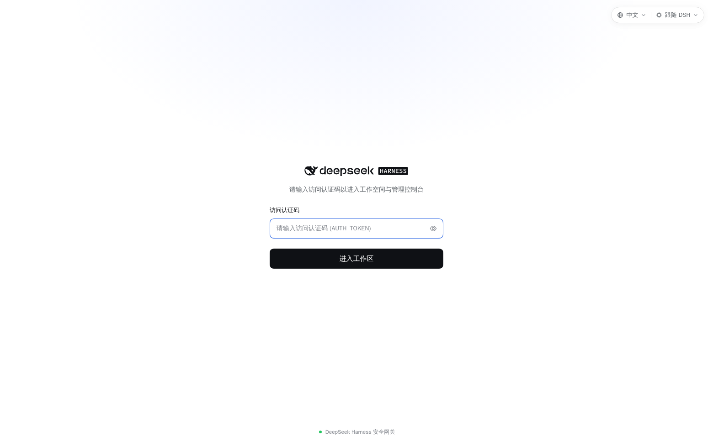 | 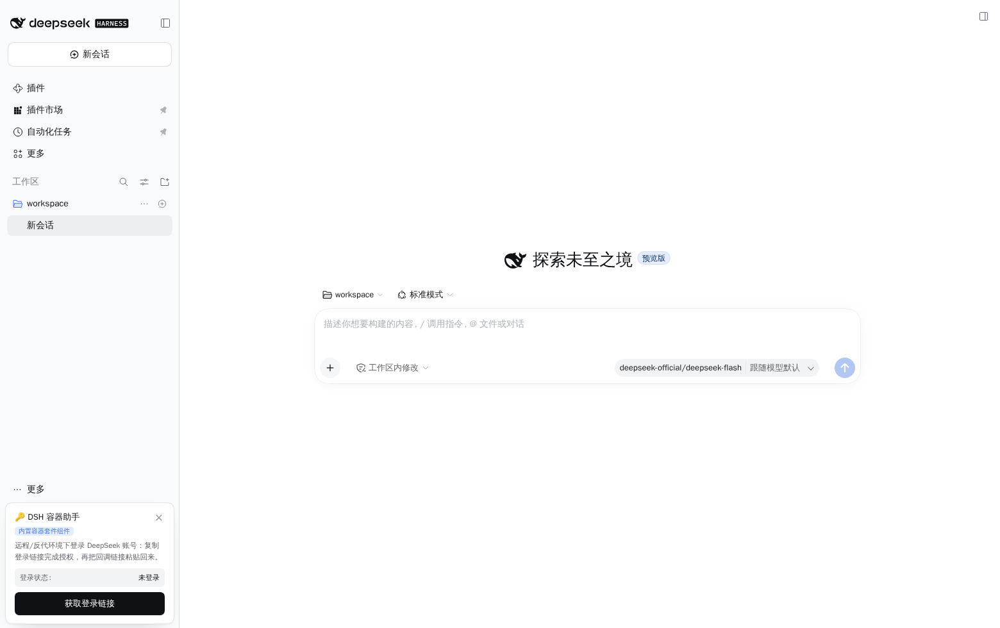 |
| 未配置口令时进入 `/setup` 强口令向导，支持 8 语言与深色模式 | 原生压缩资源透传，HTTPS 下自动升级 `wss://` |

### DSH 同源管理控制台

| DSH 核心管理 | 版本与更新控制中心 |
| :---: | :---: |
| 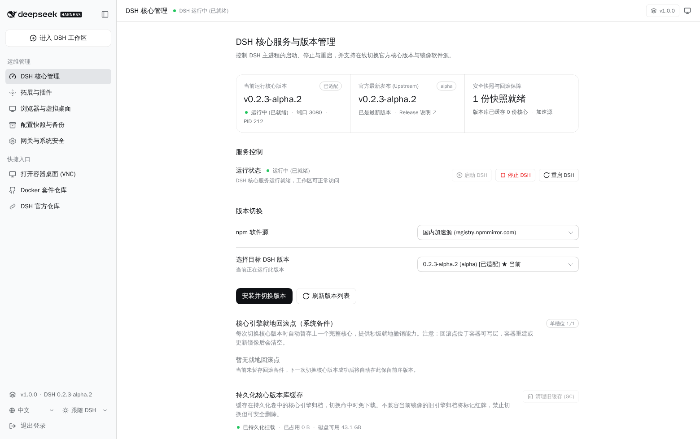 | 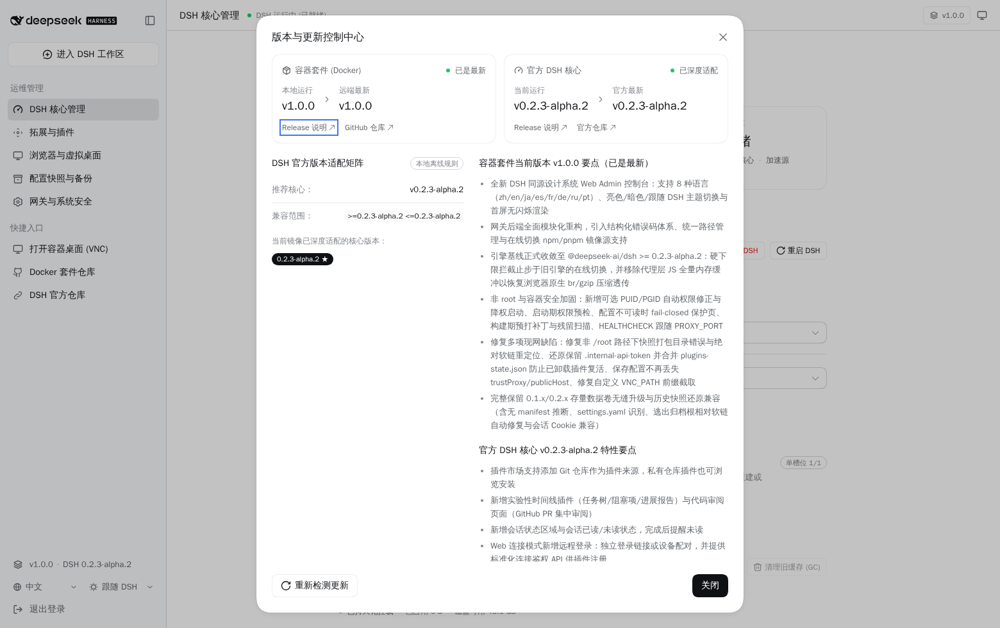 |
| 运行状态、端口 / PID、核心版本切换与 npm 软件源 | 套件 / 核心双版本状态、适配矩阵与更新要点 |

| 拓展与插件 | 浏览器与虚拟桌面 |
| :---: | :---: |
| 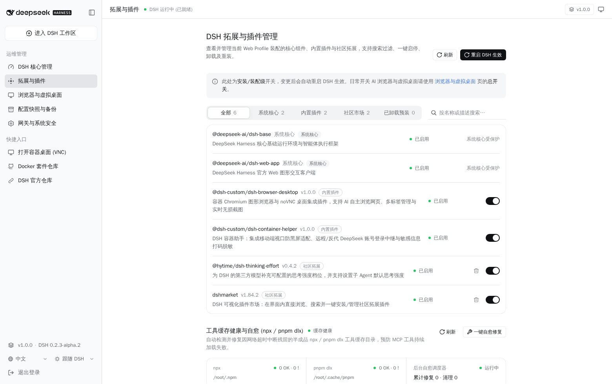 | 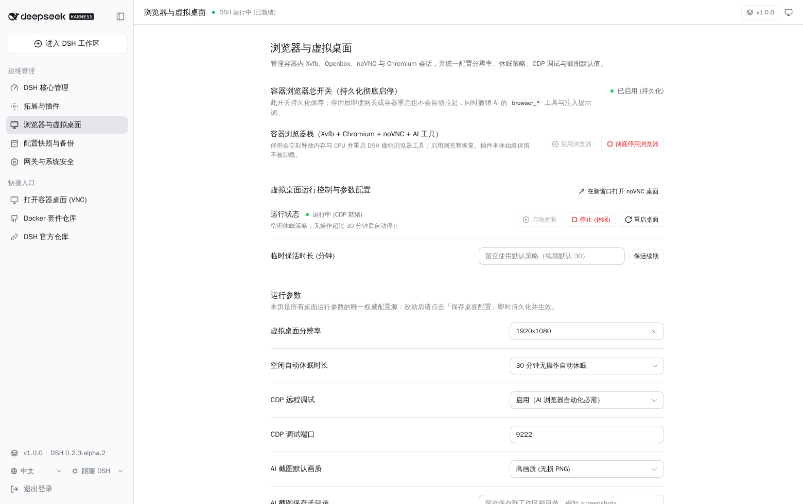 |
| 系统核心 / 内置插件 / 社区拓展分类管理，一键启停、卸载与重装 | 1080p / 2K 分辨率、CDP 9222 远程调试、空闲休眠与桌面总开关 |

| 配置快照与备份 | 快照还原范围确认 |
| :---: | :---: |
| 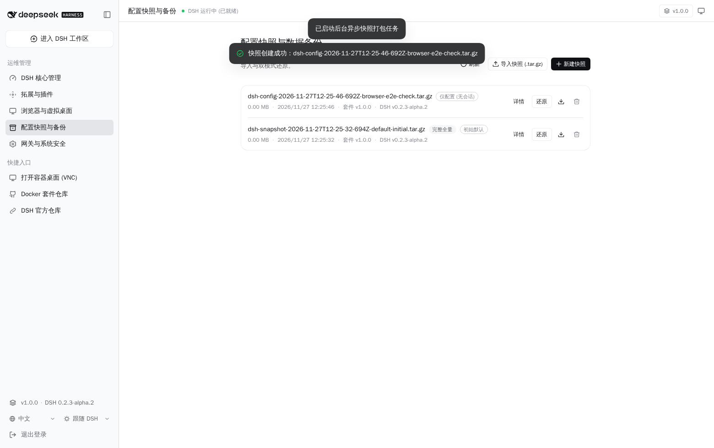 | 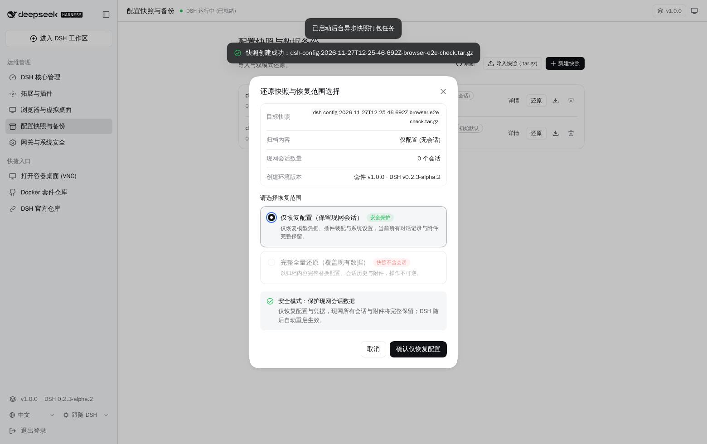 |
| 异步打包 `.dsh` 配置快照，支持外部导入与下载 | 「仅恢复配置」保留现网会话，「完整全量」覆盖现有数据 |

| 网关与系统安全（浅色） | 网关与系统安全（深色） |
| :---: | :---: |
| 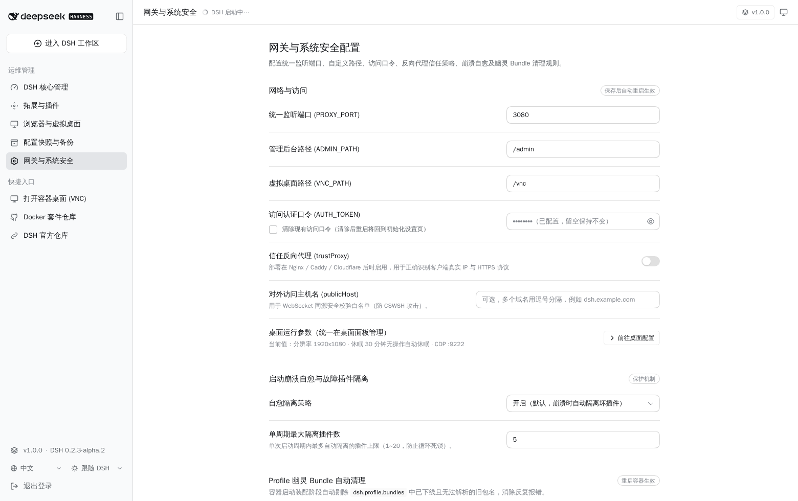 | 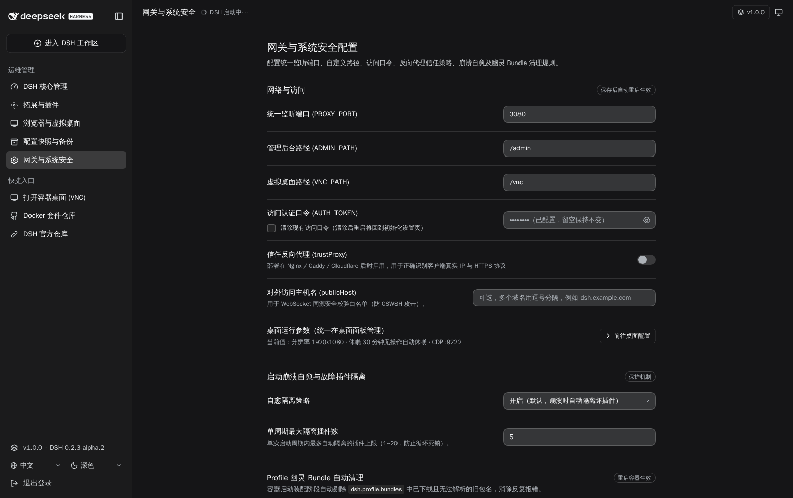 |
| 端口、管理路径、访问口令、反代信任与崩溃自愈策略 | 深色主题，与 DSH 主题设置联动 |

### 容器桌面与远程登录助手

| 容器 Chromium noVNC 桌面（`/vnc/`） | DeepSeek 远程登录助手 | 登录态检测与隐私打码 |
| :---: | :---: | :---: |
| 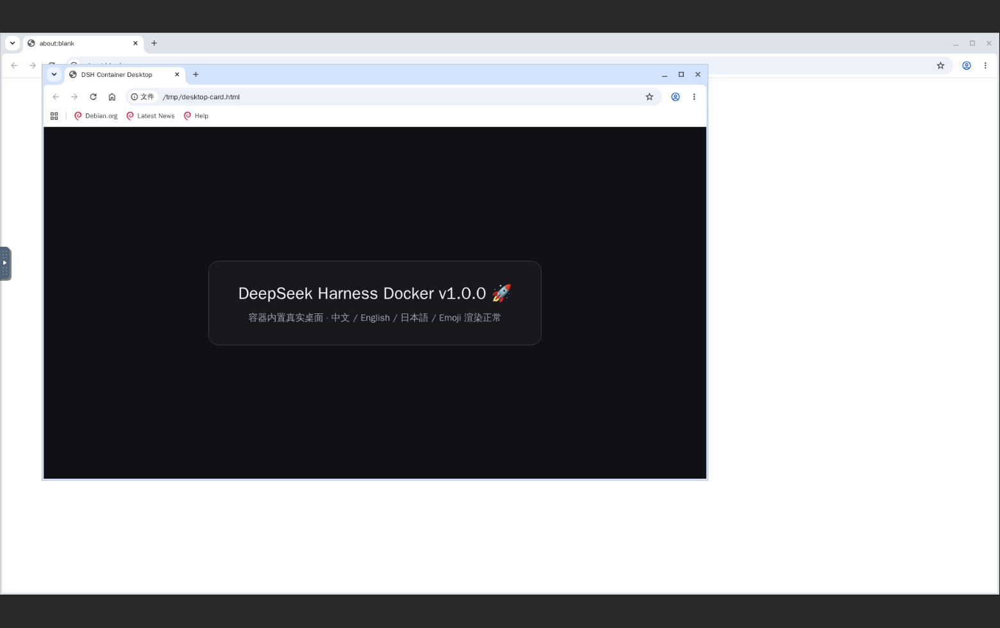 | 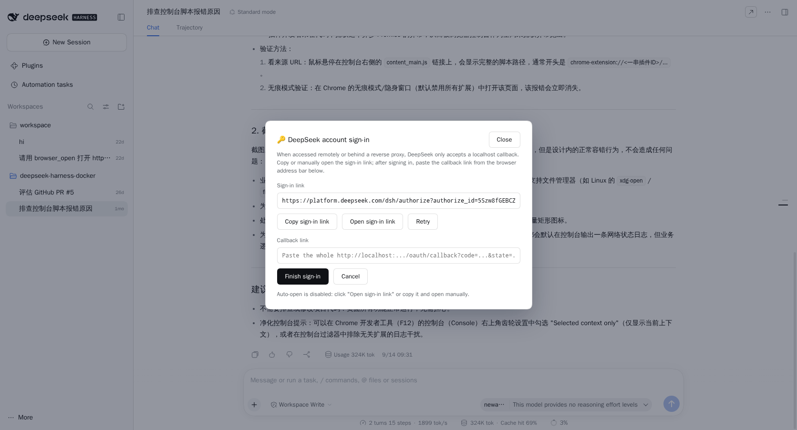 | 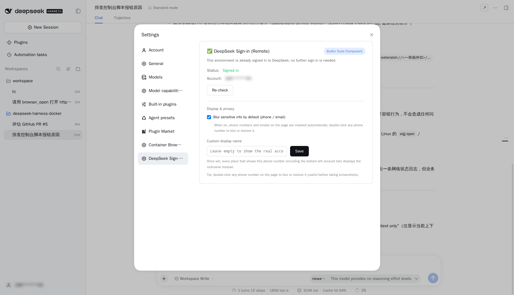 |
| 容器内真实 Chromium，支持中日英与 Emoji 渲染 | 复制登录链接、粘贴回调地址完成远程登录 | 双击手机号切换模糊 / 还原，支持自定义昵称 |

<sub>虚拟桌面与容器浏览器仅在 Standard / Market / Full 镜像中提供，Mini 镜像自动隐藏对应入口。</sub>

---

## 环境变量

| 变量名 | 默认值 | 说明 |
|---|---|---|
| `AUTH_TOKEN` | *(空)* | 访问认证码；留空时首次访问进入 `/setup` 强口令初始化向导，显式填写则覆盖持久化口令 |
| `PROXY_PORT` | `3080` | 统一对外监听端口（Web、Admin、VNC 及 `HEALTHCHECK` 探活均自动跟随） |
| `ADMIN_PATH` | `/admin` | Web Admin 管理后台访问路径 |
| `VNC_PATH` | `/vnc` | noVNC 虚拟桌面路径 *(仅 standard / market / full 生效，mini 下返回 404)* |
| `DSH_HOME` | `/root` | 运行根目录（非 root 部署时建议设为 `/home/dsh`） |
| `PUID` / `PGID` | *(空)* | 可选：root 启动时自动修正数据卷属主并通过 `setpriv` 降权运行 |
| `DSH_WORKSPACE` | `/workspace` | DSH 默认项目工作区目录 |
| `NPM_REGISTRY` | `https://registry.npmmirror.com` | 默认 npm / pnpm 镜像源（支持在管理后台在线切换并持久化） |
| `TRUST_PROXY` | `0` | 部署在可信反向代理后时设为 `1`（显式环境变量优先于持久化配置） |
| `PUBLIC_HOST` | *(空)* | 对外域名白名单（逗号分隔，用于 WebSocket 同源校验；显式环境变量优先） |
| `DSH_DESKTOP_ENABLED` | `1` | 是否启用容器虚拟桌面 *(仅 standard / market / full 生效)* |
| `DSH_DESKTOP_WIDTH` / `HEIGHT` | `1920` / `1080` | 虚拟桌面分辨率（支持在后台动态调整） |
| `DSH_SNAPSHOT_TIMEOUT_MS` | `1800000` | 快照打包/校验/还原超时时间（毫秒，默认 30 分钟，HTTP 请求超时自动联动） |
| `DSH_BACKUP_THREADS` | *(自动 ≤ 8)* | `pigz` 多线程压缩并发数（默认取可用核数且上限 8，支持 `1~64`） |
| `HTTP_PROXY` / `HTTPS_PROXY` / `NO_PROXY` | *(空)* | 出站网络代理（启用代理时自动向 `NO_PROXY` 追加 `127.0.0.1,localhost,::1`） |

完整模板见 [`.env.example`](.env.example)。

---

## 进阶部署

### 非 root 部署（`PUID`/`PGID` 与 `1001:1001`）

**方式 A：`PUID` / `PGID` 自动修正属主并降权**（推荐用于老卷迁移）

无需手工 `chown`，容器入口脚本会以 `root` 修正挂载卷与核心目录属主，随后通过 `setpriv` 降权为指定 UID/GID 运行后续全部进程：

```yaml
services:
  deepseek-harness:
    image: ghcr.io/misaka-link/deepseek-harness-docker:latest
    environment:
      - PUID=1001
      - PGID=1001
      - DSH_HOME=/home/dsh
    volumes:
      - ./data/dsh:/home/dsh/.dsh
      - ./workspace:/workspace
      - ./data/snapshots:/home/dsh/.dsh-snapshots
      - ./data/browser:/home/dsh/.config/chromium
      - ./data/npm:/home/dsh/.npm
      - ./data/pnpm-cache:/home/dsh/.cache/pnpm
```

**方式 B：纯非 root 直接启动**（`user: "1001:1001"`）

先在宿主机准备目录属主：

```bash
mkdir -p ./data/dsh ./data/snapshots ./data/browser ./data/npm ./data/pnpm-cache ./workspace
chown -R 1001:1001 ./data ./workspace
```

然后在 `docker-compose.yml` 中启用：

```yaml
    user: "1001:1001"
    environment:
      - DSH_HOME=/home/dsh
    security_opt:
      - no-new-privileges:true
    cap_drop:
      - ALL
    volumes:
      - ./data/dsh:/home/dsh/.dsh
      - ./workspace:/workspace
      - ./data/snapshots:/home/dsh/.dsh-snapshots
      - ./data/browser:/home/dsh/.config/chromium
      - ./data/npm:/home/dsh/.npm
      - ./data/pnpm-cache:/home/dsh/.cache/pnpm
```

> [!NOTE]
> 若升级时因卷内原有 `0600` 配置文件属主不匹配导致非 root 用户无法读取，网关将进入 **`503` 安全锁止页面**，展示具体文件与修复命令，不会回退到初始化向导。

### DeepSeek 账号登录（远程 / 反代访问）

DeepSeek 平台 OAuth 仅接受 `localhost` 回调地址。本套件内置回调 origin 归一补丁与「DSH 容器助手」弹窗，支持两种方式完成远程登录：

1. **SSH 本地隧道（全自动）**：执行 `ssh -L 3080:127.0.0.1:3080 <user>@<服务器IP>`，通过 `http://localhost:3080/` 发起登录，回调自动落回本机。
2. **内置插件弹窗 / 手动回调页**：点击左下角账号菜单「Sign in」（或访问 `http://<服务器IP>:3080/account/callback`），打开登录链接完成授权后，将浏览器地址栏中的 `http://localhost:<端口>/oauth/callback?code=...&state=...` 完整链接粘贴回输入框提交即可，无需手动修改主机名。

### ARM64 主机

仅 `mini` 变体（`:latest-mini` / `:1.0.1-mini`）提供 `linux/amd64` + `linux/arm64` 双架构 Manifest，适用于 Apple Silicon、树莓派、RK3588 等 ARM64 主机：

```bash
docker image inspect ghcr.io/misaka-link/deepseek-harness-docker:latest-mini -f '{{.Architecture}}'
docker run --rm ghcr.io/misaka-link/deepseek-harness-docker:latest-mini node -p process.arch
```

> 在物理 ARM64 设备上本地构建镜像时，建议预留 ≥ 3GB 空闲内存以完成原生模块编译。

---

<a id="更新日志"></a>

## 更新日志（仅最近 3 个版本）

### v1.0.1

- **修复克隆旧容器配置重建时误报「发现新版」（#24）**：`DSH_SUITE_VERSION` 采信前与镜像内 `gateway/package.json#version` 交叉校验，不一致时降级采用镜像真实版本并阻断快照元数据污染；`/admin/api/status` 与 `/admin/api/version/check` 新增 `project.versionMismatch` 与 `versionSources[].conflict` 标记，管理后台提供 8 语言冲突告警与 `--force-recreate` 重建提示。
- **补齐「容器浏览器桌面」侧栏向导与顺序管理图标**：为 `dsh-browser-desktop` 补齐稳定 `guide.id` 与 `36×36` 双色桌面浏览器矢量图标组件，消除右侧栏向导与顺序调整列表中的图标留白。
- **修复经典 `docker build`（非 BuildKit）构建兼容性**：移除 `Dockerfile` 中的 BuildKit 专属 heredoc 脚本写法，兼容未安装 `docker-buildx` 的 `amd64` / `arm64` 主机。

### v1.0.0

- **DSH 同源 Web Admin 控制台**：8 种界面语言、浅色 / 深色 / 跟随 DSH 主题切换与首屏无闪烁渲染。
- **四档镜像变体与预装插件在线更新**：提供 `standard` / `market` / `full` / `mini` 四档变体；`market` 与 `full` 预装社区插件采用标准 semver 注册，支持商店与 DSH 原生一键更新且重启保留。
- **模块化网关与长耗时备份加固**：后端按领域模块化，移除代理层 JS 全量内存缓冲恢复原生 `br` / `gzip` 流式压缩；支持有界 `pigz` 多线程并行压缩、切换前异步快照轮询与反代断连自动恢复。
- **非 root 与容器安全加固**：新增 `PUID`/`PGID` 降权启动、启动期权限预检、配置不可读 fail-closed `503` 保护页、构建期预打补丁与残留扫描、`HEALTHCHECK` 跟随 `PROXY_PORT`。
- **缺陷修复与平滑升级**：修复非 `/root` 路径快照打包与绝对软链重定位；还原保留 `.internal-api-token` 并合并 `plugins-state.json`，防止已卸载插件复活；保存配置保留 `trustProxy` / `publicHost`；修复自定义 `VNC_PATH` 前缀截取；保留 `0.x` 数据卷与历史快照无缝升级兼容。

完整变更说明见 [CHANGELOG.md](CHANGELOG.md)；`0.x` 历史版本记录已归档于 `low` 分支。

---

## 致谢

本项目在架构设计与容器化实现过程中参考了以下开源项目：

- [deepseek-ai/deepseek-harness](https://github.com/deepseek-ai/deepseek-harness)
- [runzhliu/deepseek-harness-docker](https://github.com/runzhliu/deepseek-harness-docker)
- [smanx/deepseek-harness-docker](https://github.com/smanx/deepseek-harness-docker)
